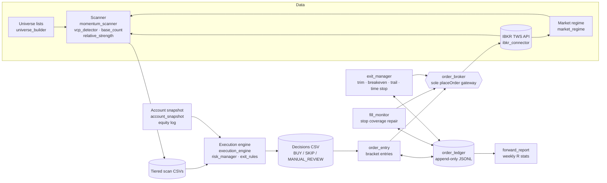
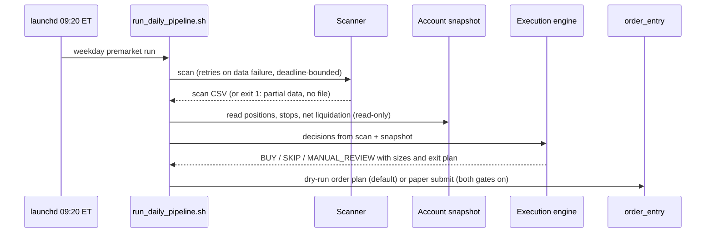

# Swing Trading Bot

A Python stock scanner and paper-first execution bot for swing trading (holds of a few days to a few
weeks) through the Interactive Brokers (IBKR) TWS API. The scanner finds momentum stocks forming
volatility-contraction bases. A rules engine turns them into sized BUY / SKIP / MANUAL_REVIEW decisions.
An order layer then places, monitors and exits bracket orders on a **paper** account. Every guard fails
closed: when a check is in doubt, nothing is sent.

> **Disclaimer.** This is a personal engineering project, not investment advice. All strategy
> thresholds in this repository (`strategy_params.py`) are **illustrative example values**. They are
> not the parameters of any live or paper strategy, they have not been optimised, and the results of
> trading with them are unknown. Order submission is **off by default** and the code refuses live
> accounts. Use at your own risk.

## Highlights

- **Scanner** (`momentum_scanner.py`): multi-threaded IBKR historical-data pull across a universe of
  watchlist symbols, a trend template, relative strength vs SPY, ATR/ADR extension, base counting,
  and detection of the volatility contraction pattern (VCP: a series of progressively shallower
  pullbacks on drying-up volume). Output is tiered CSVs (ELITE / BUY / WATCH / EXTENDED).
- **Market regime gate** (`market_regime.py`): distribution-day counts, follow-through days and index
  drawdown classify the tape. In a correction, new buys switch to watch-only.
- **Execution engine** (`execution_engine.py`): one sizing rule (`position % = risk % / stop %`,
  capped), stop bands by entry type, caps on open risk per name, industry group and sector, earnings
  blackout, scan freshness, liquidity, and loss circuit breakers fed by the account's equity history.
- **Order path**: an append-only order ledger, bracket entries, a fill and stop monitor that repairs
  coverage, and a nightly exit manager. It is built around IBKR's OCA (one-cancels-all) group behaviour.
- **Testing**: 700+ pytest tests, run with no TWS connection against a simulated broker. They include
  an OCA behaviour matrix and crash and restart scenarios.

## Architecture



### Daily pipeline



During the session, `fill_monitor.py` checks stop coverage. After the close, `exit_manager.py` turns the
exit plan (`exit_rules.py`) into the next session's orders: stop to breakeven, a resting partial trim,
market-on-open exits and a market-on-close time stop.

## Safety design

Real money is out of scope by design. The guards are layered so that no single bug can reach a live
account or oversell a position:

| Guard | Where | What it does |
|---|---|---|
| Paper-only ports | `ibkr_connector`, `order_broker.open_session` | Live ports (7496 / 4001) are refused **before** connecting |
| Paper-only accounts | `confirm_paper_session` | Every account in the session must be a paper (`DU…`) account. The `--account` must be one of them |
| Two submission gates | `order_broker` | Orders go out only if `config.AUTO_SUBMIT_ENABLED is True` (the bool, not a truthy string) **and** the CLI got `--submit`. Otherwise the connector is read-only and `placeOrder` raises |
| Single gateway | `order_broker` | The only module that calls `placeOrder` / `cancelOrder`. It refuses any `orderRef` outside its session prefix |
| Intent before send | `order_ledger` | Each intent is written and fsynced **before** `placeOrder`, so a crash leaves a trace that reconcile matches by `orderRef`. Each symbol gets one entry per day, with no resend |
| Oversell guard | `order_broker.assert_no_oversell`, `fill_monitor` | Every new SELL is capped at long shares minus every working SELL (bot and manual), so no fix can flip the account short |
| OCA brackets | `order_entry`, `exit_manager` | Parent stop-limit entry with a child stop. Trims and exits share OCA groups with the stop. A `split_stop` mode gives the trim its own stop in case TWS cancels a stop instead of reducing it |
| Circuit breakers | `risk_manager.circuit_breaker` | Daily loss or monthly drawdown halts new entries; a weekly loss cuts risk. Entries also need enough equity history since the last reset |
| Manual positions untouched | `fill_monitor`, `exit_manager` | Positions the bot didn't open, or that were changed by hand, are reported and never modified |
| Ledger lock | `order_ledger.ledger_lock` | Only one order run (entry, exit or monitor) at a time |

Pullback entries, wide stops, group-cap overflows and missing data all route to **MANUAL_REVIEW**
instead of an automatic BUY.

## Testing

```bash
pip install -r requirements.txt pytest
python -m pytest -q tests
```

- No test needs TWS. `tests/conftest.py` loads `config.template.py` as `config`, sends output to a temp
  folder and silences notifications.
- `tests/helpers.py` provides a **fake broker** (`FakeBroker`) and fake connectors, and `test_paper_checks.py` adds a
  simulated TWS (`SimBroker`). These model
  IBKR's acknowledgements, rejections, partial fills, OCA cancel and reduce semantics, and dropped
  connections between parent and child orders.
- **OCA behaviour matrix** (`test_exit_manager.py`, `test_paper_checks.py`): trim fills, gap-down
  opens where a stop and a market-on-open exit could both fill, partial fills followed by a cancel, and
  both the `shared_oca` and `split_stop` modes.
- Guard tests prove that each gate fails closed: live port, non-`DU` account, a truthy-string config
  switch, a missing `--submit`, a foreign `orderRef`, an oversell, a crash after the intent is written.
- Scanner and VCP tests use synthetic price series built to hit each tier boundary and each pattern rule.
- `scripts/paper_checks.py` is an interactive, operator-confirmed runner that checks the broker
  behaviour on a real **paper** account (for example, whether a trim fill reduces or cancels the
  OCA stop). The code's assumptions are confirmed against TWS this way before submission is enabled.

## Tech stack

Python 3.12, pandas, NumPy, IBKR TWS API (`ibapi`), `rich` for the terminal dashboard, `openpyxl`,
pytest, bash, and macOS launchd for scheduling.

## Running it (paper mode)

1. Install TWS or IB Gateway, log in to a **paper** account, and enable the API on port 7497.
2. Install `ibapi` from IBKR's TWS API download, then `pip install -r requirements.txt`.
3. `cp config.template.py config.py` and set your paper account (`IBKR_ACCOUNT = "DU…"`). `config.py`
   is git-ignored.
4. Put a universe list in `Data/` (a TradingView export or a plain `tv_YYYY-MM-DD.txt` with one ticker
   per line).
5. Run the stages:

```bash
python preflight_check.py --no-tws              # config and file checks
python momentum_scanner.py                      # scan -> Scans/*_COMPLETE.csv
python account_snapshot.py                      # read-only positions and stops (paper)
python execution_engine.py --input Scans/<scan>_COMPLETE.csv \
    --output Scans/<scan>_execution_decisions.csv --mode premarket --account-snapshot latest
python order_entry.py --decisions Scans/<scan>_execution_decisions.csv --account DUXXXXXXX   # dry-run plan
python morning_report.py --no-tws               # one-screen health check
```

Or run everything at once with `./run_daily_pipeline.sh` (dry run by default). The example launchd
jobs are in `launchd/`. Change their paths before installing them.

Submission stays off unless you set `AUTO_SUBMIT_ENABLED = True` **and** pass `--submit`. Even then,
only paper ports and `DU` accounts are accepted.

## Repository layout

| Area | Files |
|---|---|
| Scanner | `momentum_scanner.py`, `vcp_detector.py`, `base_count.py`, `pocket_pivot.py`, `relative_strength.py`, `universe_builder.py`, `ibd_universe.py`, `symbol_hygiene.py`, `scan_display.py`, `watch_mode.py`, `orb_detector.py` |
| Regime and risk | `market_regime.py`, `risk_manager.py`, `exit_rules.py`, `execution_engine.py`, `account_snapshot.py`, **`strategy_params.py`** (example values) |
| Order path | `order_broker.py`, `order_ledger.py`, `order_entry.py`, `fill_monitor.py`, `exit_manager.py`, `ibkr_paper_executor.py`, `ibkr_alert_setter.py` |
| Research and reporting | `backtest.py`, `backtest_data.py`, `forward_report.py`, `morning_report.py` |
| Infrastructure | `ibkr_connector.py`, `market_time.py`, `notify.py`, `preflight_check.py`, `run_daily_pipeline.sh`, `scripts/`, `launchd/` |

## Backtesting caveats

`backtest.py` is a daily-bar simulator with commissions and slippage. Its results are provisional.
Daily bars can't show the order of moves within a bar (the simulator has a realistic and a
pessimistic setting for this). The
universe is today's symbol list, so survivorship bias applies. Thresholds tuned on the same data
overfit. For that reason, `forward_report.py` tracks results on unseen data (paper trades and logged
signals, in R multiples) against a pre-set sample-size target before any verdict on an edge.

## License

MIT. See [LICENSE](LICENSE).
